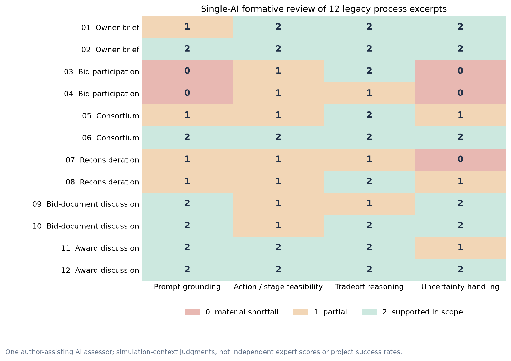
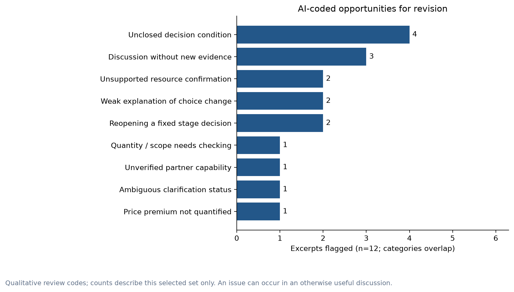

# 微观过程AI结构化初评

评审日期：2026-11-07。输入摘录和协议于2026-11-06准备。用户已明确要求由AI评审；本轮由当前对话中的Codex助手完成，不依赖等待教师评分。

## 1. 本轮结论

在此前选定的12段阶段—招标包对话中，**7段讨论贡献基本可用，5段需要修改**。主要优势是能够识别相关风险、表达岗位与组织利益差异；主要问题在于**缺少新增依据时，最终决定将待核查条件写成确认事实或肯定保证**。

这12段来自12个案例、6个阶段，共234条消息。每段是一个评审单元；不能把234条消息或多次引用当独立评分样本。全部是旧版恢复批次，未据此评价当前模型宿主的优劣。

评分为**单一、参与项目开发的AI所作的形成性评审**，不是独立人类专家评价。不是盲评或多评审一致性实验；没有填造第二位评审、kappa或独立质量增益。评审者确切后端版本和采样参数未独立记录，不补猜模型名或temperature。

## 2. 相比原草案，本轮补了哪些证据

- 234条消息都在保存的API响应中找到完全一致的文本。
- 按阶段、轮次和决定marker筛选后，232条获得唯一对应来源；PROCESS-05两条重复文本仍对应多个调用。关键扣分证据没有仅依赖这两条。
- 每条引用都核对了原文、消息ID和调用ID；关键数量、候选与报价还核对了当时的用户提示。
- 核对的是**提示内模拟前提与输出是否对齐**。前提中可能已有模型生成画像、评标意见或记忆，这些不会因被提示引用而升级为现实已验证事实。
- 原始对话、业务数据与原专家评审占位均保持不变；新增的是AI评审文件，项目provider新增API请求为0。当前对话本身的模型使用不记成项目provider试验请求。

复核的协议、评分与可追溯来源分别保存于[protocol.json](protocol.json)、[带逐项理由的AI评分](ai_review_annotations.json)、[绑定调用ID的结果](ai_review_results.json)。

## 3. 评分标准与全部结果

四维分别评0、1、2分：0为明显缺口，1为部分满足，2为给定模拟任务范围内有支持；关键资料无法取得时用NA。这里没有任意加权综合分。

“讨论贡献基本可用”指对本段所要求的讨论任务有帮助、没有观察到决定性缺陷，不等于整个标书合格、工程安全或真实商业最优。某段仍可存在局部问题；可行性1分也不意味着实际执行已经发生。

|片段|阶段|提示依据|行动／阶段可行|权衡理由|不确定性|AI判断|
|---|---|---:|---:|---:|---:|---|
|PROCESS-01|业主需求澄清|1|2|2|2|讨论贡献基本可用|
|PROCESS-02|业主需求澄清|2|2|2|2|讨论贡献基本可用|
|PROCESS-03|投标参与|0|1|2|0|需修改|
|PROCESS-04|投标参与|0|1|1|0|需修改|
|PROCESS-05|联合体协商|1|1|2|1|需修改|
|PROCESS-06|联合体协商|2|2|2|2|讨论贡献基本可用|
|PROCESS-07|失败后重议|1|1|1|0|需修改|
|PROCESS-08|失败后重议|1|1|2|1|需修改|
|PROCESS-09|标书讨论|2|1|1|2|讨论贡献基本可用|
|PROCESS-10|标书讨论|2|1|2|2|讨论贡献基本可用|
|PROCESS-11|模拟授标|2|2|2|1|讨论贡献基本可用|
|PROCESS-12|模拟授标|2|2|2|2|讨论贡献基本可用|

|维度|0分段数|1分段数|2分段数|NA段数|
|---|---:|---:|---:|---:|
|提示依据贴合|2|4|6|0|
|行动／阶段可行|0|7|5|0|
|权衡与理由|0|3|9|0|
|不确定性处理|3|3|6|0|

[SVG矢量图](AI评审四维评分.svg)。颜色是本AI评审者的判断，不是外部已校准的分数或系统各维度完成率。没有将7/12称为系统准确率。

## 4. 对capstone最有用的发现

### 4.1 有实际可用的微观过程素材

PROCESS-02展示业主围绕展陈内容、验收标准、变更成本提出不同岗位请求；PROCESS-06展示企业对主导权、付款建议审核和退出条件的独立立场；PROCESS-10能在缺技术参数时提出核查任务，而没有编出地质数值。

PROCESS-12展示低价与风险保障的定性取舍，选择理由可追到提示中的评标意见。但依照已有建议选同一家，不等于已证明组织讨论优于单智能体，也不证明高价方真实最优。

### 4.2 目前最该修的是事实状态与条件传递

PROCESS-03／04：总人数或历史项目经验，被写成当前关键岗位可调配甚至档期已确认。PROCESS-07：总结仍要求核查分包能否解决本段设定的门槛，最终却直接承诺全设计责任。PROCESS-08：拟聘顾问方案未说明资源条件仍未完成。

这些问题至少涉及两层：模型输出把假设写实；同时，流程缺少把“请核实”变成实际任务、接收新依据、再更新状态的机制。不能把全部问题只归于模型能力。

建议的数据状态最少包含：**未知 → 已请求 → 收到来源 → 核验通过／不通过**。拟定计划另列为proposed，不与已观测或已确认混用。总人数不能直接填当前可用人数；讨论共识不能直接填外部确认。

### 4.3 阶段约束和协商对象资料需要加强

PROCESS-05谈到对方智能办公设计“有专长”，但该外部谈判提示主要给了对方名称与己方立场。应先允许披露和核验对方能力，或把断言改成核查请求。

PROCESS-09／10部分发言重开联合体选择，而当前标书阶段提示已锁定单一投标方式。应区分落实已定方案、必要时正式发起重议两种任务，避免在每一轮重复参投问题。

[SVG矢量图](AI评审问题分布.svg)。问题类别非互斥，也包含可用讨论中的局部改善点，不能将柱数求和作为失败次数。

## 5. 三个具体修改示例（建议，不是新实验输出）

|原句与来源|建议改写|应补的证据或机制|
|---|---|---|
|PROCESS-04 `msg_000091`：关键岗位人员档期已初步确认|拟按该岗位方案组建团队；当前尚未取得关键人员档期确认，计划不构成资源已可用的证明|人员排期回复、来源ID、确认日期与适用项目|
|PROCESS-05 `msg_000141`：你们在这方面有专长|请提供智能办公系统专项能力和可投入团队的允许披露摘要，核对后再确认责任分工|对方独立披露与接受，不由本方替对方编承诺|
|PROCESS-07 `msg_000420`：承诺承担全部设计责任|当前是附条件的投标准备方案；关于本段设定的业绩和责任条件，仍需取得明确答复后更新决定|保留条件与实际回复；不把讨论中的资格主张当现实法规结论|

## 6. 如何用于论文

方法名称建议使用 **AI-assisted formative process review** 或 **single-LLM qualitative assessment**，披露评审者与开发的关系、12段长度条件抽样、评分量表、提示来源与逐项依据。当前12段按6阶段各选2段，且限制3–80条消息，不能据此估计总体业务合格率。

可以写：本轮AI审查在给定模拟资料范围内识别了讨论贡献、未关闭条件、资源确认措辞和阶段边界问题，并将观察转为后续测试需求。不要写已完成人类专家验证、已证明组织审议提升质量、或整个系统准确率为7/12。

本轮也不能替换原模型R/S/D主实验的独立同题比较。12段旧批次对话与当前报价小试不是同版本配对，不能把本轮AI评分直接塞进当前三模式质量主表。

## 7. 逐段评审与引用

### PROCESS-01 · case-0195 · 业主需求澄清

**AI初评：讨论贡献基本可用。** 围绕EPC需求、审查权和价格机制提出了有依据的澄清请求；投资额与面积口径尚未统一，单位造价异常不能直接作为工程复杂度事实。

- **提示依据贴合 1/2**：原提示明确给出8130.3平方米与人民币72000万元，消息正确使用了数量级；但未给常规住宅单价、计容口径或投资范围，不能证实‘远超常规’。地下空间只被表述为可能性，未当成已观测工程事实。
- **行动／阶段可行 2/2**：当前任务是业主早期需求澄清；要求价格机制与审查边界草案属于合理下一步，没有凭讨论生成正式合同或许可。
- **权衡与理由 2/2**：识别业主审查控制、EPC成本激励与独立监管的权衡，分别由技术、商务、管理岗位提出具体请求。
- **不确定性处理 2/2**：地下空间和结构复杂度保留‘可能’，并要求后续评估；建议再明确核对面积、币种及投资范围。

可复核依据：

- `msg_000001`／`attempt_001_call_000015`：原文“这提示项目可能包含地下空间或特殊结构”。识别假设并保留不确定性，不能把该句改写为已证实地下工程。
- `msg_000002`／`attempt_001_call_000016`：原文“请商务组提供一份价格评审机制草案”。把成本疑问转为可交付的澄清任务。

修改建议：把‘单方造价远超常规住宅’改为‘按当前面积粗算的投资强度较高，先核对面积口径与投资包含范围，再判断是否存在异常’。不改动原始输出，仅用于下一版措辞建议。

结论边界：不核证真实工程造价或EPC法律条款；未评价后续正式招标文件完整性。

[原始摘录](../../论文图表/微观验证证据图册/评审准备/PROCESS-01.md) · [模型调用来源与完整提示](来源核对/PROCESS-01.json)

### PROCESS-02 · case-0198 · 业主需求澄清

**AI初评：讨论贡献基本可用。** 能将展览馆的功能、技术验收、设计审查和变更成本联系起来，提出范围内的需求澄清。

- **提示依据贴合 2/2**：项目名称与EPC背景支持围绕核能科普、展陈设备和交付标准提出需求问题；没有把未取得的功能清单写成已经收到。
- **行动／阶段可行 2/2**：要求工程或设计管理职能确认展陈范围、审查权与标准草案，符合本段需求细化任务。
- **权衡与理由 2/2**：技术准确性、设备可靠性、成本变更和总包／专项接口均被纳入；这些是多岗位讨论贡献，尚不是比较实验中的质量增益。
- **不确定性处理 2/2**：持续指出需求清单与交付标准尚未提供，并要求后续确认；没有在结尾伪造通过验收的事实。

可复核依据：

- `msg_000003`／`attempt_001_call_000017`：原文“EPC总包范围是否包含展陈设计施工一体化”。先核对范围而非直接认定专项已另行委任。
- `msg_000005`／`attempt_001_call_000019`：原文“目前功能需求清单和交付标准草案尚未提供”。把资料不足带入后续请求。

修改建议：保留该段作为正面过程示例；后续把功能需求清单作为实际任务产物关联，避免请求在讨论中反复出现却无回执。

结论边界：不据本段认定招标范围、技术标准或正式审批已经确定。

[原始摘录](../../论文图表/微观验证证据图册/评审准备/PROCESS-02.md) · [模型调用来源与完整提示](来源核对/PROCESS-02.json)

### PROCESS-03 · case-0006 · 投标参与

**AI初评：需修改。** 团队能比较独立投标与联合体，但总量人员信息被最终管理说明提升为当前可调配能力，缺少新增核实依据。

- **提示依据贴合 0/2**：输入中的89名顾问、162个完成项目是组织规模与履历；未给当前人员排期或资源确认。最终说明却称关键角色有充足人员可调配，中央可行性依据未得到独立来源支持。
- **行动／阶段可行 1/2**：投标意向本身并非履约承诺或合同成立；但以当前资源已满足为理由支持独立投标，仍有决定性核验缺口。
- **权衡与理由 2/2**：讨论明确比较独立监察控制力、联合体补资源和协调成本，角色意见具有相关性。
- **不确定性处理 0/2**：总结仍要求提交人员分配情况，下一条管理输出就断言人员充分，中间没有人员确认消息。

可复核依据：

- `msg_000086`／`attempt_001_call_000101`：原文“请项目经理本周内提交人员分配情况”。最终决定前仍未取得本项目可用性核查。
- `msg_000087`／`attempt_001_call_000114`：原文“关键角色均有充足人员可调配”。把尚待确认的排期能力写成了既成事实。

修改建议：将人员说明改成附条件的拟投入计划；关联真实可用性回复后才能称人员已确认。若输出空间只允许bid／no_bid／consortium，须在意向与后续资源门槛之间保留明确状态。

结论边界：没有证据证明企业现实中无能力；本意见仅指出模拟输入与确认措辞之间的来源缺口。

[原始摘录](../../论文图表/微观验证证据图册/评审准备/PROCESS-03.md) · [模型调用来源与完整提示](来源核对/PROCESS-03.json)

### PROCESS-04 · case-0020 · 投标参与

**AI初评：需修改。** 多家公司从要求核对团队直接转为确认人员到位，且部分最终选择没有解释为何偏离前序条件。

- **提示依据贴合 0/2**：COMP-0453有总人数信息，不代表关键岗位档期已确认；COMP-0522人员到位也没有对应核验回复。
- **行动／阶段可行 1/2**：提出计划人数可以是合理投标计划，但‘已确认’与‘拟投入’必须分开；当前不能由计划证明实际可用。
- **权衡与理由 1/2**：讨论提到独立性、补资源和费用；最终独立投标未逐项回应总结中的资源条件或解释策略转向。
- **不确定性处理 0/2**：待核实的资源和财务资料在最终决定中被弱化，形成讨论与最终输出断层。

可复核依据：

- `msg_000082`／`attempt_001_call_000098`：原文“必须先确认内部团队可用性”。讨论自己提出了前置核验条件。
- `msg_000091`／`attempt_001_call_000112`：原文“关键岗位人员档期已初步确认”。在所匹配的管理提示中没有独立排期确认来源。
- `msg_000097`／`attempt_001_call_000101`：原文“若伙伴合适，我们以联合体投标”。前序总结倾向有条件联合体；下一条转独立投标应说明条件与理由。
- `msg_000098`／`attempt_001_call_000113`：原文“投标策略：独立投标”。策略可以改变，但不能只以拟定岗位计划替代缺失资源核验。

修改建议：最终决策输出增加尚未关闭的条件与变更理由，并把拟投入名单与已获确认人员分成不同字段。

结论边界：不把‘拟投入7人’本身当作虚假事实；问题是声称已确认与决定依据缺失。

[原始摘录](../../论文图表/微观验证证据图册/评审准备/PROCESS-04.md) · [模型调用来源与完整提示](来源核对/PROCESS-04.json)

### PROCESS-05 · case-0160 · 联合体协商

**AI初评：需修改。** 能表达各方独立立场和责任条件，但对候选伙伴的专项能力存在未经资料支持的直接断言。

- **提示依据贴合 1/2**：外部谈判提示给出对方名称、范围与己方当前立场，并未提供对方已核实的智能办公系统专项能力；消息却以该专长作为责任分配前提。
- **行动／阶段可行 1/2**：有主导权、连带责任和接口分工讨论，但团队及专项能力证据尚缺，不能据这些意向认定联合体整体可交付。
- **权衡与理由 2/2**：明确区分普通分包与共享投标身份，独立投标方也保留否决条件，体现了多方利益差异。
- **不确定性处理 1/2**：多数语句保留若不担责则不成立的条件，但对能力本身缺少同等保留；多轮重复请求候选资料，未见新资料进入。

可复核依据：

- `msg_000141`／`attempt_002_call_000158`：原文“你们在这方面有专长”。提示未给相应已核实能力档案，宜改为向对方核实。
- `msg_000144`／`attempt_002_call_000161`：原文“请明确贵司的承诺”。最终仍在寻求承诺，不能把本段作为已达成全体协议的证据。
- `msg_000150`／`attempt_002_call_000168`：原文“市场部尚未提供候选伙伴资质”。未关闭的信息请求在后轮继续出现。

修改建议：对方专项能力改为待验证命题；先提供对方允许披露的能力摘要，再谈具体责任与可接受条件。保存未达成状态，不因多轮讨论增加形成率。

结论边界：不判断现实企业真实资质。两条同文消息仍有来源调用歧义，关键判断未以这两条作为唯一证据。

[原始摘录](../../论文图表/微观验证证据图册/评审准备/PROCESS-05.md) · [模型调用来源与完整提示](来源核对/PROCESS-05.json)

### PROCESS-06 · case-0008 · 联合体协商

**AI初评：讨论贡献基本可用。** 较好体现不同企业独立判断、监督独立性和责任边界；各方没有被迫无条件达成联合体。

- **提示依据贴合 2/2**：各方在给定模拟立场内讨论监理、造价与合同管理，主要表达条件性合作意向，不把己方意见写成他方已接受。
- **行动／阶段可行 2/2**：区分监督主导权、付款建议审核与现场职责；保留独立投标和条件性联合，属于谈判范围内的行动。
- **权衡与理由 2/2**：讨论控制权、协调成本、现场资源与费用分配，利比明确可提供独特造价／合同支持，另一方仍可坚持独立。
- **不确定性处理 2/2**：要求披露伙伴及其与被监管方关系，保留费用与资源承诺条件；未把有条件愿意合作等同签约。

可复核依据：

- `msg_000346`／`attempt_001_call_000369`：原文“确认无利益冲突后再决定”。将独立性条件保留到决策。
- `msg_000359`／`attempt_001_call_000382`：原文“我方不参与现场监督决策，但保留对付款建议的审核权”。提出具体且可区分的责任界面。
- `msg_000360`／`attempt_001_call_000383`：原文“否则，我们将坚持独立投标”。保持独立参与方的拒绝或退出立场。

修改建议：可作为组织间协商的正面过程案例；补充正式条件核验与各方回执后，再研究是否形成有效协议。

结论边界：不是现实监理资格核证，不证明谈判使结果优于无谈判。

[原始摘录](../../论文图表/微观验证证据图册/评审准备/PROCESS-06.md) · [模型调用来源与完整提示](来源核对/PROCESS-06.json)

### PROCESS-07 · case-0144 · 失败后重议

**AI初评：需修改。** 重议确实引用联合体失败，但‘分包能否解决关键门槛’的条件没有得到回答就转成单独投标。

- **提示依据贴合 1/2**：联合体失败、能力缺口和55人组织规模来自已给模拟资料；最终计划未说明如何获得满足关键业绩／责任条件的新依据。
- **行动／阶段可行 1/2**：单独投标并非必然不可行，但本段自己将资格与全包责任设为关键条件；这些条件尚未关闭，不能由一份未来分包计划证明可行。
- **权衡与理由 1/2**：有外部支持成本与机会损失的讨论，最终理由没有解决团队自己提出的‘普通分包是否足够’矛盾。
- **不确定性处理 0/2**：总结明确若不能确认则退出，下一条决定没有该核查结果却承诺承担全部设计责任。

可复核依据：

- `msg_000419`／`attempt_001_call_000454`：原文“若市场部能确认分包业绩可计入我方资格”。这是讨论内部提出的条件，不是本评审对现实法规的判断。
- `msg_000420`／`attempt_001_call_000456`：原文“公司承诺承担全部设计责任”。最终输出未关联解决先前门槛疑问的新增来源。

修改建议：保留‘有条件准备投标’与待核验条件；获得对该条件的明确答复后再更新策略。不能把角色讨论中的资格主张视为真实法律结论。

结论边界：不认定该企业现实中不具备设计资格，也不认定现实分包业绩一定不能计入。

[原始摘录](../../论文图表/微观验证证据图册/评审准备/PROCESS-07.md) · [模型调用来源与完整提示](来源核对/PROCESS-07.json)

### PROCESS-08 · case-0196 · 失败后重议

**AI初评：需修改。** 重议能区分普通分包与联合体，但最终投标说明对外部资源能否落实过于肯定。

- **提示依据贴合 1/2**：4519人总规模与施工背景可以支持一般能力判断，不能证明机电顾问、分包商和当前档期已落实。最终多为将来计划，不全是事实幻觉，但应明确条件。
- **行动／阶段可行 1/2**：总包作为单一责任方管理专业分包符合本模拟提供的决策范围；关键外部资源仍缺确认，故只能作有条件方案。
- **权衡与理由 2/2**：围绕外部支持成本、工期、质量责任与退出机会作了具体权衡。
- **不确定性处理 1/2**：前序多次要求核查外部可用性，最终‘确保’措辞没有说明这些条件仍开放。

可复核依据：

- `msg_000303`／`attempt_001_call_000332`：原文“若可行，我们单独投标；否则考虑退出”。明确提出外部可用性条件。
- `msg_000304`／`attempt_001_call_000336`：原文“确保关键分包商和顾问的可用性”。是未来保证措辞，不能作为资源已经核验的事实。
- `msg_000310`／`attempt_001_call_000333`：原文“先摸一下本地机电和结构分包的市场价和可用性”。另一家公司也有尚待核查的成本与档期。

修改建议：把‘确保可用’改为‘拟落实，当前待确认’，列出可用性和价格确认的责任人及触发条件；不因为引用了失败记录就认定已发生有效适应。

结论边界：不把拟聘请顾问、拟安排人员本身判为不允许的计划。

[原始摘录](../../论文图表/微观验证证据图册/评审准备/PROCESS-08.md) · [模型调用来源与完整提示](来源核对/PROCESS-08.json)

### PROCESS-09 · case-0026 · 标书讨论

**AI初评：讨论贡献基本可用。** 作为标书编制的讨论贡献，能正确保留分包核验与审查接口问题；主要短板是反复请求但没有新增依据。

- **提示依据贴合 2/2**：讨论持续以已给设计包、岩土与交通接口缺口为背景，未直接把分包资质或资源写成已确认。
- **行动／阶段可行 1/2**：要求分包评估摘要、独立复核和版本接口确认是可行下一步；但提示已锁定单一投标方式，个别意见仍重开联合体选择，阶段边界跟踪不充分。
- **权衡与理由 1/2**：提及单一问责、协调成本、付款与质量风险，但多轮内容重复，未形成更明确的优先级或方案比较。
- **不确定性处理 2/2**：在最后一轮仍明确分包能力尚未确认，并要求提供证据；未用总结代替核实。

可复核依据：

- `msg_000438`／`attempt_001_call_000525`：原文“工程部尚未确认分包商岩土资质和监管责任划分”。明确保留未知条件。
- `msg_000454`／`attempt_001_call_000572`：原文“请市场部反馈具体证据”。最后一轮仍要求证据，没有声称收到。

修改建议：保留为正面不确定性处理示例；把重复问题改成有编号的问题单，只有收到新资料或条件变化才重开一轮。

结论边界：未检查独立BID_DOCUMENT产物，因此不据这段对话判断最终标书质量或提交完整性。

[原始摘录](../../论文图表/微观验证证据图册/评审准备/PROCESS-09.md) · [模型调用来源与完整提示](来源核对/PROCESS-09.json)

### PROCESS-10 · case-0167 · 标书讨论

**AI初评：讨论贡献基本可用。** 能把独立复核资源、设计依据、风险预留和工期冲突转为具体核查请求，并保持未知状态。

- **提示依据贴合 2/2**：讨论围绕给定隧道、桥墩托换与独立复核需求，没有凭空给出地质参数、报价或实际核验结论。
- **行动／阶段可行 1/2**：核查复核人员、审查节点和设计参数属于可行任务；但部分意见仍提出重新启动联合体，与该阶段‘不重开参与方式’的提示不完全一致。
- **权衡与理由 2/2**：将复核资源、质量承诺、进度和成本预留联系起来；不足时提出调整质量方法或引入外部复核的条件性方案。
- **不确定性处理 2/2**：明确没有详细参数不能给合理成本区间，在最后总结仍保留复核资源缺口，没有编出数值。

可复核依据：

- `msg_000351`／`attempt_001_call_000414`：原文“若资源不足，我们需调整质量方法或考虑分包”。把资源状态与下一步选择建立联系。
- `msg_000361`／`attempt_001_call_000418`：原文“需要设计团队提供详细的地质参数和初步支护方案”。未把缺失的技术输入用想象数值补齐。

修改建议：可作为信息不足时合理提出核查任务的正面案例；后续需接问题回执，单独评价实际标书产物。

结论边界：不核证真实隧道／托换设计安全，不以讨论内容代替工程计算或正式复核。

[原始摘录](../../论文图表/微观验证证据图册/评审准备/PROCESS-10.md) · [模型调用来源与完整提示](来源核对/PROCESS-10.json)

### PROCESS-11 · case-0004 · 模拟授标

**AI初评：讨论贡献基本可用。** 在唯一有效模拟报价下，判给对象和金额与输入一致，并保留风险澄清；澄清状态仍需结构化表达。

- **提示依据贴合 2/2**：唯一候选联合体、MOP316万元和成本构成均在匹配提示中；六项成本独立相加为316万元。
- **行动／阶段可行 2/2**：在提供的唯一候选及评标推荐范围内形成判给意见，没有另造候选。待澄清内容可作为后续条件，不意味着应强制拒绝唯一报价。
- **权衡与理由 2/2**：关注岩土设计投入、风险预备金、协调成本和质量保障，而非只看总价。
- **不确定性处理 1/2**：最终保留澄清清单，但‘判给前澄清’和现时判给措辞的状态不够明确，应标出哪些尚未完成。

可复核依据：

- `msg_000448`／`attempt_001_call_000492`：原文“报价MOP 3,160,000”。对象与金额可在原始AWARD提示中直接核对。
- `msg_000451`／`attempt_001_call_000506`：原文“判给前的澄清重点包括”。输出列了澄清事项，但没有逐项给出已确认或待确认状态。

修改建议：将判给意见、合同签署条件和澄清完成状态分开记录；本文接受的是有风险说明的模拟判给建议，不认定澄清或合同已经完成。

结论边界：单候选任务没有展示排序选择能力；不评价现实采购程序合法性。

[原始摘录](../../论文图表/微观验证证据图册/评审准备/PROCESS-11.md) · [模型调用来源与完整提示](来源核对/PROCESS-11.json)

### PROCESS-12 · case-0001 · 模拟授标

**AI初评：讨论贡献基本可用。** 能在低价与风险保障之间作出可追溯取舍，最终推荐与给定评标输入一致，并保留签约前的审核要求。

- **提示依据贴合 2/2**：输入同时给出联合体MOP400万元、艾奕康MOP1140万元及评标的质量与风险意见；输出据此选择艾奕康，未把历史真实赢家当作依据。
- **行动／阶段可行 2/2**：候选企业在输入可选集合内，签约前细化分包审核与节点的请求处于业主评审范围。
- **权衡与理由 2/2**：明确承认高报价的成本压力，并以风险保障和审查配合解释选择；仍缺量化的溢价价值判断，但就本段定性模拟任务可接受。
- **不确定性处理 2/2**：对低价方的独立校审和储备保留核查疑问，最终对已选方也要求合同前细化，而不是宣称所有承诺已经落实。

可复核依据：

- `msg_000509`／`attempt_001_call_000551`：原文“联合体报价低很多，对预算压力小”。讨论未忽略低价方案的真实成本优势。
- `msg_000512`／`attempt_001_call_000571`：原文“其报价虽高于联合体，但风险储备充足”。选择理由能回到提示中的评标意见；‘充足’是输入评价，不是本评审重新核证。
- `msg_000512`／`attempt_001_call_000571`：原文“在合同签订前，进一步明确分包成果审核流程和关键审查节点”。保留后续条件，不将其当作已完成核查。

修改建议：保留为定性权衡正面案例；后续独立核查评标中风险储备和审查配合的依据，若需比较最优方案，再声明预算或效用准则。

结论边界：与评标推荐一致不等于现实最优；也不能证明多智能体审议造成了更好授标。

[原始摘录](../../论文图表/微观验证证据图册/评审准备/PROCESS-12.md) · [模型调用来源与完整提示](来源核对/PROCESS-12.json)

## 8. 可复现性

输入协议与原始来源：[来源匹配汇总](source_match_summary.json)、[阶段轮次消歧](source_disambiguation_summary.json)、[优选调用索引](preferred_source_links.json)。两条剩余歧义原样保留，没有为了提高匹配率强行指定调用。

`ai_review_annotations.json`是本对话AI逐段判读后写出的评分和理由，不是规则自动造分。脚本仅校验引用、来源哈希、枚举与算术并绘图：`.\.venv-integration\Scripts\python.exe -X utf8 scripts/report_capstone_ai_review_20261107.py`。重新执行不等于第二个独立评审者，也不会产生新的质量样本。
