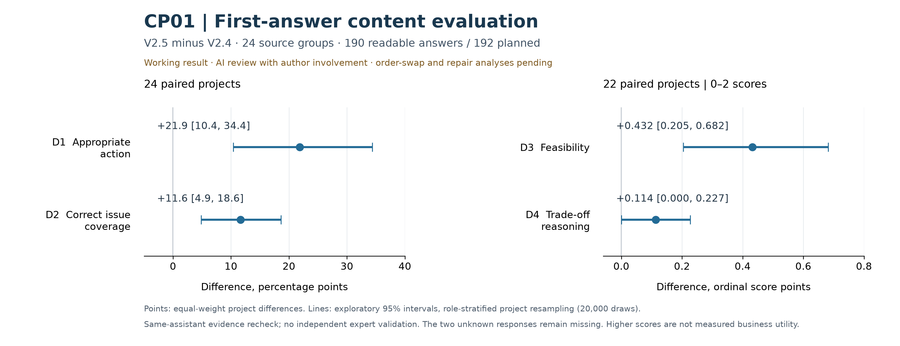

# CP01首轮业务结果：24源组的工作版本

190份可读首轮已逐项评分并完成一次同助手证据复核；192个计划槽位中的2次未知不重放、不造分。本表比较V2.5与V2.4的版本差异，不是S／D3／S4组织流程比较。修复回答未替换首轮，也未混入本表。

## 项目配对结果

重复内先聚合，完整／缺资料两情景等权，再项目等权。D1／D2用24项目；D3／D4按预定repeat=1细评，两项目的一个情景因未知不能构成完整配对，因此观测配对n=22。区间为按角色分层、项目配对重采样20000次（seed=20261112）的探索性95%百分位区间。

| 指标 | V2.4项目均值 | V2.5项目均值 | 差值V2.5−V2.4 | 探索性95%区间 | 配对项目n |
|---|---:|---:|---:|---:|---:|
| 适当行动比例 | 67.71% | 89.58% | +21.88个百分点 | [10.42, 34.38]个百分点 | 24 |
| 正确事项覆盖 | 58.85% | 70.49% | +11.63个百分点 | [4.86, 18.65]个百分点 | 24 |
| 可实施性（0—2） | 1.341 | 1.773 | +0.432分 | [0.205, 0.682]分 | 22 |
| 权衡推理（0—2） | 1.864 | 1.977 | +0.114分 | [0.000, 0.227]分 | 22 |

D1／D2是项目等权后的比例，不是把所有原始回答或事项直接拼成一个成功率。D3／D4等级均值与分差只作有序评分描述，不是精确连续商业效用。D4区间含0，且存在量表天花板，不写“已证明全部四维改善”。

[SVG图](figures/CP01_first_review_001/CP01_first_answer_effects.svg) · [作图数据](figures/CP01_first_review_001/figure_data.csv) · [逐项目描述CSV](analysis/CP01_first_review_complete_001/CP01/rechecked_case_descriptions.csv)

## 缺失与影响分析

| 指标 | 全24计划项目的缺失赋值边界 | 逐项目剔除后的均值差范围 |
|---|---:|---:|
| D1 | [20.833, 22.917]个百分点 | [18.478, 23.913]个百分点 |
| D2 | [10.799, 12.882]个百分点 | [9.964, 12.790]个百分点 |
| D3 | [0.375, 0.458]分 | [0.357, 0.452]分 |
| D4 | [0.125, 0.208]分 | [0.071, 0.143]分 |

缺失边界依固定量表范围向两个版本作相反有利／不利填充，针对全部24个计划项目；它不是实际评分，也不是抽样区间。D3／D4的观测点与区间针对22个完整配对，人口不同，不能要求观测点一定落在全24项目的数学缺失边界内。完整重复槽位和逐复用企业剔除结果分别保存在四份指标JSON中，不依据效应方向删除案例。

## 事项构成与等级分布

| 版本 | correct | partial | missing | contradicted | 不可判断 |
|---|---:|---:|---:|---:|
| v2_4 | 295 | 136 | 15 | 47 | 0 |
| v2_5 | 360 | 105 | 27 | 12 | 0 |

上表是已评首轮原始事项计数；不同角色每份有5或6个事项，且两次未知均在V2.4。它用于描述错误构成，不把这些事项当独立样本；主D2仍按每回答归一化及项目配对公式。

| 指标 | 版本 | 0分 | 1分 | 2分 | 未知无评分 |
|---|---|---:|---:|---:|---:|
| D3 | v2_4 | 5 | 20 | 21 | 2 |
| D3 | v2_5 | 0 | 12 | 36 | 0 |
| D4 | v2_4 | 0 | 7 | 39 | 2 |
| D4 | v2_5 | 0 | 1 | 47 | 0 |

等级表仅含预定repeat=1回答，保留完整／缺资料两情景。它是回答级描述，不改变项目级统计单位。

## 当前可以写的结论与边界

在该固定24源组、当前模型／提示和作者辅助AI量表下，V2.5的适当行动、正确事项覆盖和可实施性评分的观测项目差为正；本工作版本相应探索区间未含0。权衡推理的差异较小、区间触及0，不据此宣称等效、非劣或普遍改善。

评分中仍保留V2.5的无来源现有业务／制造能力断言、可选核查升级、项目特点遗漏和施工方案泛化等反例。尚未完成的行动构成、资料条件差中差及预选顺序互换不能由这张均值表替代，也不能据此称改善不是由行动构成变化造成。

初评包可见版本标识，助手参与设计；一次引文复核和项目重采样不构成独立专家验证或去偏保证。见[评阅与输入边界](评价与数据边界记录_001.md)。预选顺序互换及单列修复分析完成后须版本化更新结论，不覆盖原评和本结果。CP00、CP08、CP07及宏观／反馈仍分别推进，本批不代替整个Capstone验证。

[逐项汇总与来源哈希](CP01_first_review_business_summary_001.json) · [分析清单](analysis/CP01_first_review_complete_001/CP01/analysis_manifest.json) · [首轮去向索引](business_readiness_CP01_first_review_complete_001.json)
